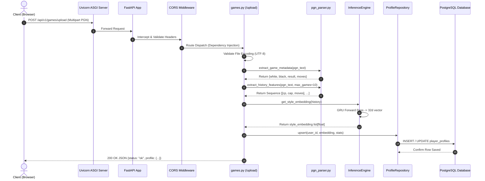
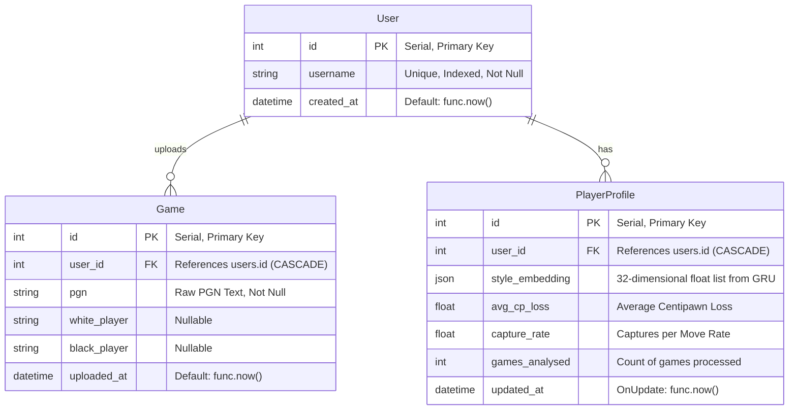

# 04 — System Architecture Diagrams

This document contains Mermaid diagrams capturing the end-to-end system, request lifecycles, and cross-cutting concerns.

---

## Diagram 1: Complete End-to-End Application Architecture

```mermaid
flowchart TD
    subgraph Client ["Client Layer (Browser)"]
        UI_Dash["Dashboard (index.html)"]
        UI_Play["Interactive Play (play.html)"]
        UI_Sim["Style Map (similarity.html)"]
        JS_API["api.js (ES6 Fetch)"]
        JS_WS["WebSocket Client"]
    end

    subgraph Backend ["FastAPI Backend Layer (Uvicorn)"]
        App["FastAPI App Factory (main.py)"]
        CORS["CORS Middleware"]
        RouterGames["Games Router (/api/v1/games)"]
        RouterWS["WebSocket Router (/ws/play)"]
        PGNParser["PGN Parser (pgn_parser.py)"]
        Repo["Repository Layer (repository.py)"]
    end

    subgraph CachingAndDB ["Persistence & Caching"]
        Postgres[("PostgreSQL 15\n(Users, Profiles, Games)")]
        RedisCache[("Redis 7\n(FEN + Style Inference Cache)")]
    end

    subgraph ML ["Machine Learning System (Inference)"]
        InfEngine["InferenceEngine Singleton"]
        Model["ChessStyleNet\n(ResNet Torso + GRU HistoryEncoder)"]
        Weights[("Checkpoint File\n(chess_style_net.pt)")]
    end

    %% Client to Backend
    UI_Dash -->|Upload PGN / Fetch Profile| JS_API
    UI_Sim -->|Query Cosine Similarity| JS_API
    UI_Play -->|Real-time FEN stream| JS_WS

    JS_API -->|HTTP REST Requests| App
    JS_WS <-->|Bidirectional WS Events| App

    App --> CORS
    CORS --> RouterGames
    CORS --> RouterWS

    %% Games Router flow
    RouterGames -->|Parse PGN| PGNParser
    RouterGames -->|Store / Query data| Repo
    Repo -->|SQLAlchemy ORM| Postgres

    %% WebSocket flow & ML integration
    RouterWS -->|Query Top Moves & Blunder| InfEngine
    RouterGames -->|Compute Style Embedding| InfEngine

    InfEngine <-->|Check Cache (SHA256 FEN+Hist)| RedisCache
    InfEngine -->|Model Forward Pass| Model
    Weights -.->|Loaded on Startup| Model
    InfEngine -->|Return Legal Masked Top-K| RouterWS
    RouterWS -->|Stream Predictions| JS_WS
```

---

## Diagram 3: FastAPI Backend Request Lifecycle



---

## Diagram 8: Database Entity-Relationship (ER) Diagram



