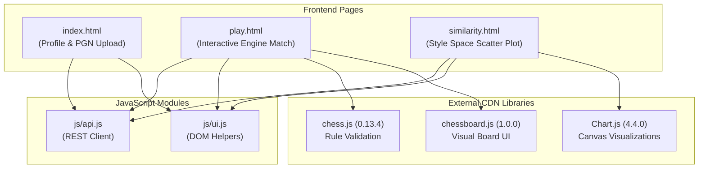

# 05 — Frontend Architecture & UI Guide

## 1. Design Philosophy
The frontend is deliberately built using **Vanilla Web Technologies** (HTML5, Modern ES6+ JavaScript, CSS3) with **no build tools** (no Node.js, Webpack, Vite, or npm required). This keeps deployment instantaneous and makes the architecture clean, lightweight, and straightforward to explain in system design interviews.

---

## 2. Page & Component Structure



---

## 3. Detailed Walkthrough of Pages

### A. Dashboard & Upload (`frontend/index.html`)
- **Purpose**: Welcomes the user, displays their current style stats, and allows uploading raw PGN files.
- **Workflow**:
  1. User selects a `.pgn` file and clicks **Analyze Games**.
  2. The page calls `uploadPGN(file, username)` in `api.js`.
  3. On success, `ui.js` updates the Style Metrics Card:
     - **Average Centipawn Loss** ($cp$ accuracy gauge).
     - **Capture Rate** (aggressiveness indicator).
     - **Games Analyzed** counter.
     - Confirmation of the 32-dimensional embedding generated by the GRU.

### B. Interactive Play (`frontend/play.html`)
- **Purpose**: Play against the engine in real-time or analyze arbitrary positions.
- **Components**:
  - `chessboard.js`: Renders the $8 \times 8$ SVG piece board.
  - `chess.js`: Maintains client-side game state, ensures only legal moves are dragged, and formats FEN strings.
  - **Live WebSocket Client**:
    ```javascript
    const ws = new WebSocket("ws://localhost:8000/ws/play");
    ```
  - **Move Evaluation Panel**: Displays Top-$k$ moves suggested by `ChessStyleNet` with probability bars and blunder risk meter.
  - **Style Selector**: Allows switching between "Neutral Style" and uploaded "Player Style".

### C. Style Similarity Map (`frontend/similarity.html`)
- **Purpose**: Computes mathematical style similarity between two players.
- **Components**:
  - **Cosine Similarity Calculator**: Queries `/api/v1/games/similarity?username_a=X&username_b=Y`.
  - **Chart.js Scatter Plot**: Projects the 32-dimensional player style embeddings onto a 2D canvas (Aggression vs Positional Accuracy) so users can visually inspect stylistic clusters.

---

## 4. Client-Side API Layer (`frontend/js/api.js`)
All communication with the FastAPI backend is encapsulated in `api.js`:
- `uploadPGN(file, username)`: Sends a `multipart/form-data` POST request.
- `getProfile(username)`: Fetches a user's style vector and statistical metrics.
- `getSimilarity(userA, userB)`: Requests cosine similarity comparison.
- `checkHealth()`: Pings `/health` to verify server availability.

