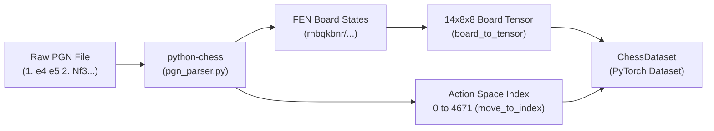

# 08 — Chess Data Pipeline & Board Representation

## 1. Overview of the Pipeline
Machine learning models cannot process raw algebraic chess moves (`"e4"`, `"Nf3"`, `"O-O"`) directly. The chess data pipeline converts human game records into normalized multidimensional tensors.

---

## 2. Input Representation: 14-Channel Board Tensor (`src/core/board_encoding.py`)
Each board state is encoded as a float tensor of shape **$(14, 8, 8)$**:

| Channel Indices | Feature Description | Values |
|---|---|---|
| **0 – 5** | White pieces: `P`, `N`, `B`, `R`, `Q`, `K` | `1.0` if piece present, else `0.0` |
| **6 – 11** | Black pieces: `p`, `n`, `b`, `r`, `q`, `k` | `1.0` if piece present, else `0.0` |
| **12** | Active Color / Turn indicator plane | All `1.0` if White to move, all `0.0` if Black |
| **13** | Castling Rights plane | Fractional float indicating White/Black kingside/queenside availability |

### Canonical Flipping for Black
To allow the network to learn a single generalized policy regardless of color, when it is Black's turn to move:
1. The board is flipped vertically ($rank \to 7 - rank$).
2. Piece planes are swapped (channels $0-5 \leftrightarrow 6-11$).
3. The network always evaluates the position from the perspective of the player whose turn it is.

---

## 3. Action Space: 4,672 Discrete Move Classes
Chess move prediction is modeled as a **4,672-class classification problem**, adopting the AlphaZero move encoding scheme:
- For each of the 64 squares on an $8 \times 8$ board, there are 73 possible move directions/types:
  - **56 Queen-like moves**: Up to 7 squares in 8 compass directions (N, NE, E, SE, S, SW, W, NW).
  - **8 Knight jump moves**: The standard 8 "L"-shapes.
  - **9 Pawn underpromotions**: Promoted to Knight, Bishop, or Rook (forward, left-diagonal capture, right-diagonal capture). Queen promotions are subsumed under queen-like moves.

$$\text{Total Classes} = 64 \times 73 = 4,672$$

---

## 4. Player History Sequence Extraction (`backend/ml/pgn_parser.py`)
To capture a player's style across time, `extract_history_features()` parses up to the last 10 games played by that user into a sequence:
$$\mathbf{H} \in \mathbb{R}^{10 \times 3}$$

For each game $t \in [1, 10]$:
1. **$cp\_loss$ (Centipawn Loss)**: Evaluates tactical precision against Stockfish-like thresholds.
2. **$capture\_rate$**: Ratio of captures to total ply count (measures tactical aggression).
3. **$move\_count$**: Total moves before resignation/checkmate (measures propensity for long endgames vs short tactical shootouts).

