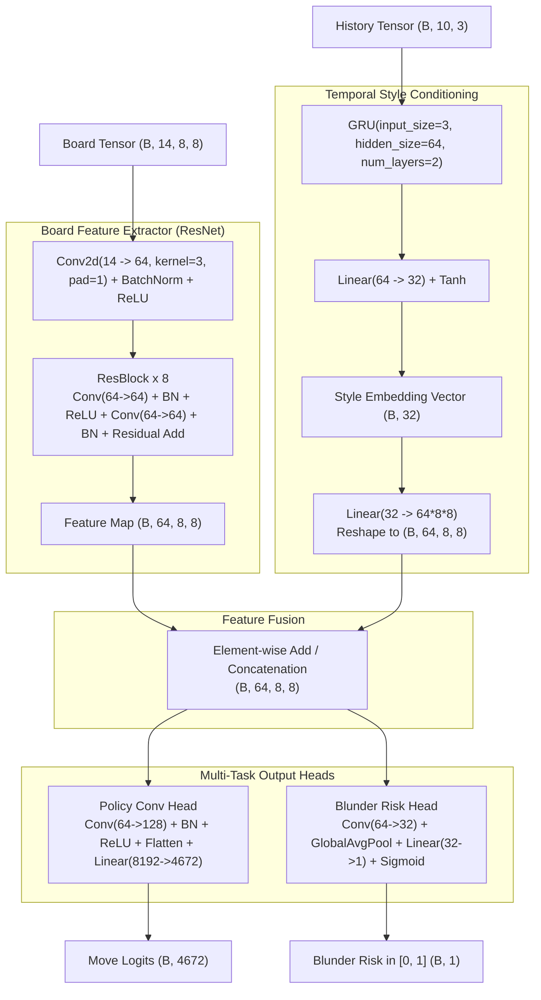

# 09 — Machine Learning Model Architecture: ChessStyleNet

## 1. Network Overview & Philosophy
`ChessStyleNet` (`src/ml/model.py`) is a **hybrid ResNet + Recurrent Neural Network**. It rejects simple categorical one-hot embeddings for players (which fail completely when encountering unseen users) in favor of a **continuous history-based style encoder**.

---

## 2. Mathematical Components of ChessStyleNet

### A. ResNet Board Torso
- Input: $\mathbf{X}_{\text{board}} \in \mathbb{R}^{B \times 14 \times 8 \times 8}$.
- Initial Convolution: Projects 14 planes to 64 feature maps.
- **8 Residual Blocks**:
  $$\mathbf{F}(x) = \text{ReLU}(\text{BN}(\text{Conv}_2(\text{ReLU}(\text{BN}(\text{Conv}_1(x)))))) + x$$
- Preserves spatial resolution at $8 \times 8$ so piece positions and board coordinates are not distorted by downsampling.

### B. HistoryEncoder (GRU Subnetwork)
- Input: $\mathbf{H} \in \mathbb{R}^{B \times 10 \times 3}$ (past 10 games $\times$ 3 style metrics).
- Bidirectional/stacked 2-layer GRU extracts hidden state $h_{10} \in \mathbb{R}^{64}$.
- Linear projection with $\tanh$ activation produces the normalized style vector:
  $$\mathbf{v}_{\text{style}} \in [-1, 1]^{32}$$

### C. Style Fusion
The 32-dimensional style vector is projected back to $64 \times 8 \times 8$ spatial dimensions using a learned linear mapping, then fused with the board feature representation:
$$\mathbf{Z} = \mathbf{Z}_{\text{board}} + \text{Reshape}(\mathbf{W}_s \mathbf{v}_{\text{style}})$$

### D. Multi-Task Heads
1. **Move Policy Head**:
   - Classifies among 4,672 candidate moves:
     $$\mathbf{z}_{\text{policy}} = \mathbf{W}_p \mathbf{Z} + \mathbf{b}_p \in \mathbb{R}^{4,672}$$
2. **Blunder Head (Auxiliary Loss)**:
   - Predicts whether the move played in this position is a blunder (probability $\in [0, 1]$):
     $$\hat{y}_{\text{blunder}} = \sigma(\mathbf{W}_b \text{GAP}(\mathbf{Z}) + b_b)$$

