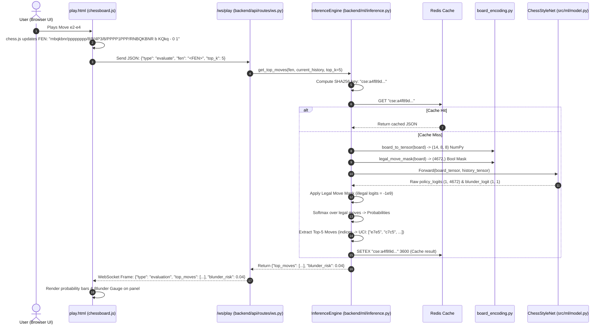

# 11 — Complete Chess Prediction & Inference Flow

This document details the exact runtime path from the instant a user drags a chess piece in their web browser to the moment the engine responds with its style-conditioned move suggestion.

---

## 1. Step-by-Step Execution Trace



---

## 2. Deep Dive: Legal Move Masking

A critical flaw in standard language/vision models applied to games is that they can predict **illegal moves** (e.g., jumping through pieces, moving into check). 

`InferenceEngine` solves this mathematically via **Logit Masking**:
1. It queries `python-chess` for all legal moves in the position:
   ```python
   legal_moves = list(board.legal_moves)
   ```
2. It builds a boolean mask vector $\mathbf{M} \in \{0, 1\}^{4672}$:
   $$M_i = \begin{cases} 1 & \text{if move } i \text{ is legal} \\ 0 & \text{otherwise} \end{cases}$$
3. For every illegal move ($M_i = 0$), the raw logit $z_i$ is replaced with a massive negative scalar:
   $$\tilde{z}_i = \begin{cases} z_i & \text{if } M_i = 1 \\ -10^9 & \text{if } M_i = 0 \end{cases}$$
4. When Softmax is computed:
   $$P(\text{move}_i) = \frac{e^{\tilde{z}_i}}{\sum_{j} e^{\tilde{z}_j}}$$
   Since $e^{-10^9} \approx 0$, the probability of selecting an illegal move becomes **identically 0.0**, while preserving the relative probability ranking among all legal choices!

