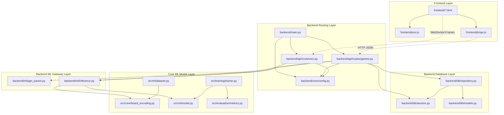

# 14 — File Dependency Map & Cross-Module Imports

This document diagrams how the modules and layers depend on each other, demonstrating the clean separation of concerns and adherence to the Dependency Inversion Principle.

---

## 1. Module Dependency Graph

---

## 2. SOLID Architectural Highlights

| Principle | Where Applied in the Code | Architectural Benefit |
|---|---|---|
| **S** — Single Responsibility | `backend/api/routes/games.py` handles HTTP only; `backend/db/repository.py` handles SQL only; `src/core/board_encoding.py` handles tensor bitboard transformations only. | Testing one component does not require bootstrapping the database or ML models. |
| **O** — Open/Closed | `backend/main.py` registers new routers via `app.include_router()` without modifying core app initialization logic. | New game modes or agent features can be attached cleanly. |
| **L** — Liskov Substitution | Custom PyTorch models inherit from `torch.nn.Module`, ensuring interchangeable forward-pass contracts in trainers and evaluators. | Any drop-in model matching the `(B, 14, 8, 8) -> (B, 4672)` contract works instantly. |
| **I** — Interface Segregation | WebSocket endpoint (`/ws/play`) receives only `fen` and `history`; REST endpoints expose narrow, focused JSON schemas. | Clients never request or transfer unneeded overhead. |
| **D** — Dependency Inversion | `InferenceEngine` depends on the abstract `ChessStyleNet` interface, completely decoupled from the training scripts (`trainer.py`). | Inference can execute in production without loading training dependencies or datasets. |

